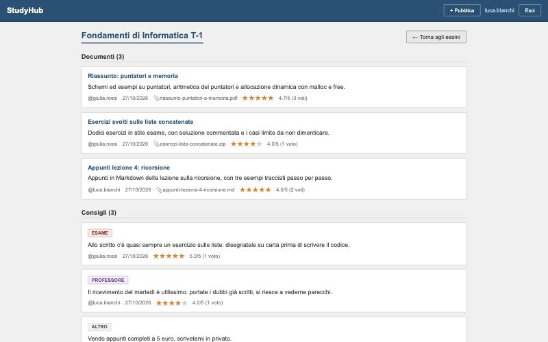
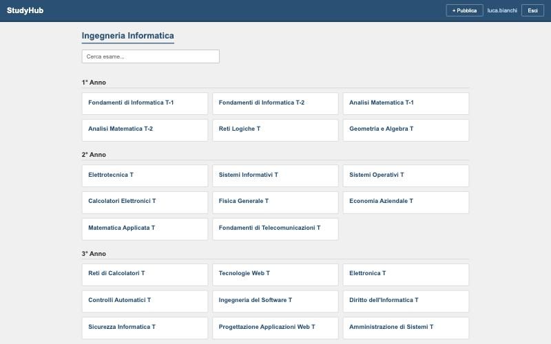
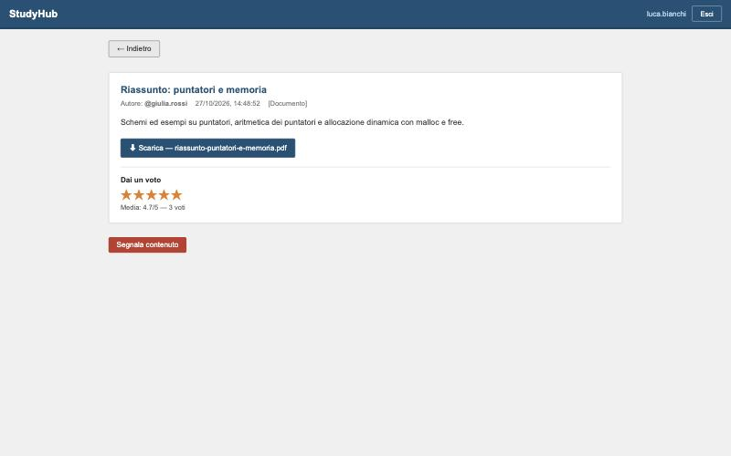
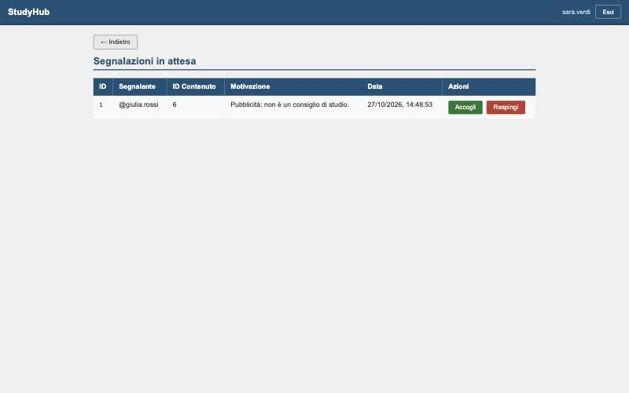
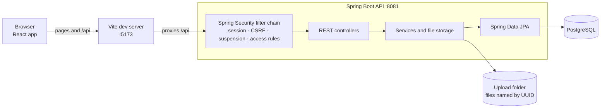
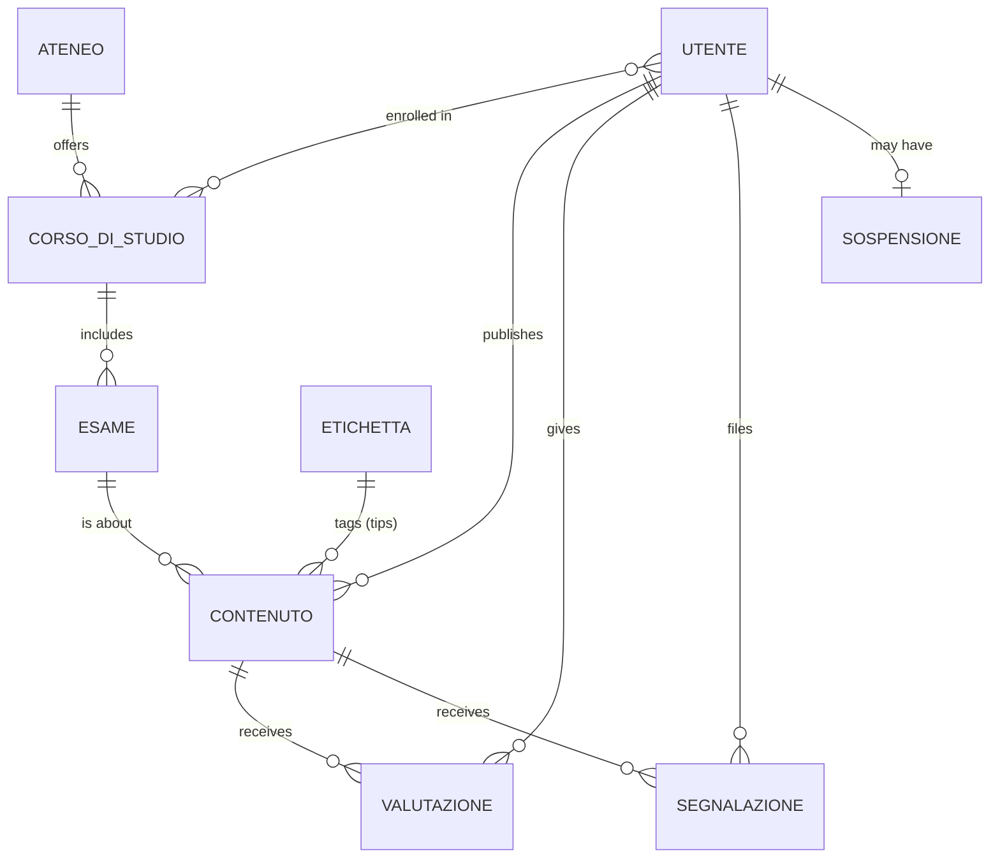

# StudyHub

A web app where university students share lecture notes, documents and study tips for each exam, rate them, and report inappropriate content to moderators.

> **Bachelor's thesis project** · Computer Engineering (Ingegneria Informatica), University of Bologna · October 2026
> Author: Alberto Manella · Supervisor: Marco Patella


The user interface is in Italian. The [glossary](#glossary) translates the domain terms used in the code.



## Contents

- [Features](#features)
- [Screenshots](#screenshots)
- [Tech stack](#tech-stack)
- [Architecture](#architecture)
- [Getting started](#getting-started)
- [Configuration](#configuration)
- [Security](#security)
- [Tests](#tests)
- [Project structure](#project-structure)
- [Data model](#data-model)
- [Glossary](#glossary)
- [Development workflow](#development-workflow)
- [Known limitations and roadmap](#known-limitations-and-roadmap)
- [License](#license)

## Features

- **Accounts:** registration and login with server-side sessions.
- **Exams:** the exams of the degree course, grouped by year, with search.
- **Documents:** upload notes, slides, exercises or code (PDF, Office, images, ZIP, any text or code file, up to 20 MB) with a title and description; download them with their original name.
- **Tips:** short text advice for an exam, tagged by category (professor, exam, lecture, theory, exercise, other).
- **Ratings:** 1–5 stars per user and content, with the average shown everywhere. Users can change their rating but not rate their own content.
- **Reports:** users can report a content once, with a reason.
- **Moderation:** moderators review pending reports. Accepting one deletes the content and gives its author a warning; from the third warning on, each accepted report suspends the author for 7 days. Moderators can also suspend users manually.
- **Suspensions:** a suspended user cannot log in, and an open session is closed on its next request.

## Screenshots

| Exams of the course | Content page with the user's rating |
|---|---|
|  |  |

| Moderation |
|---|
|  |

## Tech stack

| Layer | Technologies |
|---|---|
| Backend | Java 21, Spring Boot 4.1 (Spring MVC, Spring Security 7, Spring Data JPA / Hibernate 7), Flyway, embedded Tomcat |
| Database | PostgreSQL 16, run with Docker Compose |
| Frontend | React 18, React Router 6, Vite 5 |
| Tests | JUnit 5, Spring Boot Test, MockMvc, Spring Security Test |

## Architecture



- **One origin for the browser.** The Vite dev server forwards `/api` to the backend, so pages and API share an origin and the session cookie is first-party. In production the same role would be played by a reverse proxy serving both under one domain.
- **Every request passes the security filter chain** before reaching a controller: it finds the session, checks the CSRF token on requests that change data, logs out suspended users and applies the access rules.
- **The schema is versioned with Flyway** (`backend/src/main/resources/db/migration`): Hibernate only validates it.

## Getting started

**Prerequisites:** Java 21, Maven 3.9+, Node.js 18+, Docker.

```bash
git clone https://github.com/albertomanella/studyhub.git
cd studyhub
cp .env.example .env        # then set DB_PASSWORD to a password of your choice
docker compose up -d        # starts PostgreSQL
```

Start the backend:

```bash
cd backend
mvn spring-boot:run
```

On first start, Flyway creates the schema and loads the reference data (the university, the course, its exams and the tip categories).

In a second terminal, start the frontend:

```bash
cd frontend
npm install
npm run dev
```

Open http://localhost:5173 and register a new user.

**Moderators:** registration only creates normal users. To make a registered user a moderator, add their username to `.env` and restart the backend:

```bash
MODERATORS=mario,giulia
```

The role applies from the next login. Removing a name from the list does not revoke the role.

## Configuration

All settings live in `.env` at the repository root, read by both Docker Compose and the backend. `.env` is ignored by Git; `.env.example` documents every variable.

| Variable | Default | Purpose |
|---|---|---|
| `DB_PASSWORD` | *(required)* | Database password |
| `DB_NAME` | `studyhub_db` | Database name |
| `DB_USERNAME` | `studyhub_user` | Database user |
| `DB_HOST` / `DB_PORT` | `localhost` / `5432` | Where the backend finds the database; Docker publishes it on `127.0.0.1` only |
| `UPLOAD_DIR` | `./uploads` | Folder for uploaded files, relative to where the backend starts (`backend/uploads` with Maven); the full path is logged at startup |
| `MODERATORS` | *(empty)* | Comma-separated usernames promoted to moderator at startup |
| `CORS_ALLOWED_ORIGINS` | `http://localhost:5173` | Origins allowed to call the API from a browser, needed only if the frontend is served from another domain |
| `SESSION_COOKIE_SECURE` | `false` | `true` in production behind HTTPS |
| `SERVER_ADDRESS` | `127.0.0.1` | Network interface the backend listens on |

## Security

- **Server-side sessions.** Login checks the password with BCrypt through Spring Security and stores the user in a session on the server. The browser only receives an `HttpOnly`, `SameSite=Lax` session cookie, and the session ID changes at login (session fixation protection). Identity is never taken from the request body or URL.
- **CSRF protection** with the double-submit cookie pattern: the token comes in a cookie readable by the frontend and must be sent back in the `X-XSRF-TOKEN` header on every request that changes data.
- **Authorization** in one place: everything except registration and login requires a session, `/api/moderatore/**` requires the moderator role, and only authors can delete their content.
- **Suspensions enforced on every request** by a filter in the security chain, not only at login.
- **File uploads:**
  - known document formats must match their real signature (magic bytes), so a renamed executable is rejected
  - any other file must be text, which allows code in any language without a list of extensions
  - files are stored under random UUIDs, so the user's file name never reaches the file system
  - uploads and downloads are streamed with constant memory
  - files are always served as downloads with `nosniff`
- **Configuration:** credentials come from environment variables. The database and the development backend listen on localhost only, and CORS is limited to the frontend's origin.
- **Errors:** login gives the same error for an unknown user and a wrong password, and a suspension is revealed only after a correct password.

## Tests

```bash
docker compose up -d   # the tests use the development database
cd backend
mvn test
```

37 integration tests send real HTTP requests through the whole Spring Security chain (MockMvc), logged in as specific users. Each test runs in a transaction that is rolled back, so it leaves no data behind.

| Test class | Covers |
|---|---|
| `TestAuthController` | login, logout, sessions, CSRF, 401 without a session, suspensions during an open session |
| `TestContenutiController` | the author comes from the session, delete ownership, CSRF |
| `TestUpload` | signature and text checks, empty files, path components in names, streamed download, file cleanup on delete and on accepted reports |
| `TestValutazioniController` | rating range, no rating of your own content, one rating per user, the user's own rating in responses |
| `TestSegnalazioniController` | duplicate reports, role checks, automatic and manual suspensions |
| `TestPromozioneModeratori` | moderator promotion from configuration |
| `TestCookieHttp` | cookies sent to anonymous requests, on a real server |

## Project structure

```
studyhub/
├── backend/                         Spring Boot API
│   ├── pom.xml
│   └── src/
│       ├── main/java/com/studyhub/
│       │   ├── controllers/         REST endpoints
│       │   ├── dto/                 objects sent as JSON
│       │   ├── models/              JPA entities
│       │   ├── repositories/        Spring Data JPA repositories
│       │   ├── security/            security configuration, filters, current user, moderator promotion
│       │   ├── services/            operations spanning several entities
│       │   └── storage/             upload validation and file storage
│       ├── main/resources/
│       │   ├── application.properties
│       │   └── db/migration/        Flyway migrations (V99 = reference data)
│       └── test/java/…              integration tests
├── frontend/                        React app
│   ├── vite.config.js               dev server and /api proxy
│   └── src/
│       ├── auth/AuthContext.jsx     current user, from the server session
│       ├── services/api.js          API client: CSRF header, errors, 401 handling
│       ├── pages/                   one component per page
│       └── components/
├── docs/screenshots/
├── docker-compose.yml               PostgreSQL
├── .env.example                     configuration template
└── .github/pull_request_template.md
```

## Data model



- `CONTENUTO` is a single table for both kinds of content (`tipo` = `documento` or `consiglio`), mapped with JPA single-table inheritance.
- A user has at most one rating and one report per content (unique constraints), and at most one suspension row, renewed in place.
- Uploaded files are on disk under a UUID; the database keeps the UUID (`nome_file`) and the original name (`nome_originale`).

## Glossary

| Italian (code) | English |
|---|---|
| Utente | User |
| Profilo | Profile |
| Ateneo | University |
| Corso di studio | Degree course |
| Esame | Exam |
| Contenuto | Content |
| Documento | Document |
| Consiglio | Tip |
| Etichetta | Tag / category |
| Valutazione | Rating |
| Segnalazione | Report |
| Moderatore | Moderator |
| Avvertimento | Warning |
| Sospensione | Suspension |

## Development workflow

- **Issues** describe each change and when it is done. The [v1.0 milestone](https://github.com/albertomanella/studyhub/milestones) tracks the first release; issues without a milestone are the backlog.
- **Branches** are short-lived and named `type/what-it-does` (e.g. `fix/document-description`).
- **Commits** follow [Conventional Commits](https://www.conventionalcommits.org): `feat`, `fix`, `refactor`, `test`, `docs`, `build`, `chore`, with an optional scope such as `auth` or `db`.
- **Pull requests** follow the [template](.github/pull_request_template.md) (summary, why, changes, how it was tested), close their issue with `Closes #N`, and are squash-merged, so `main` has one commit per change.

## Known limitations and roadmap

- One university and one degree course are hardcoded in the frontend ([#16](https://github.com/albertomanella/studyhub/issues/16)).
- Request bodies are not validated field by field, so some invalid input returns a generic 500 error ([#12](https://github.com/albertomanella/studyhub/issues/12)).
- The tests use the development database instead of a disposable one ([#13](https://github.com/albertomanella/studyhub/issues/13)), and there is no continuous integration yet ([#14](https://github.com/albertomanella/studyhub/issues/14)).
- `open-in-view` is still enabled ([#23](https://github.com/albertomanella/studyhub/issues/23)).
- Sessions are kept in the memory of a single backend instance: restarting it logs everyone out, and several instances would need shared session storage.
- There is no email verification, password reset or login rate limiting.
- Uploads are limited per file (20 MB) but not per user.

## License

[MIT](LICENSE) © 2026 Alberto Manella
